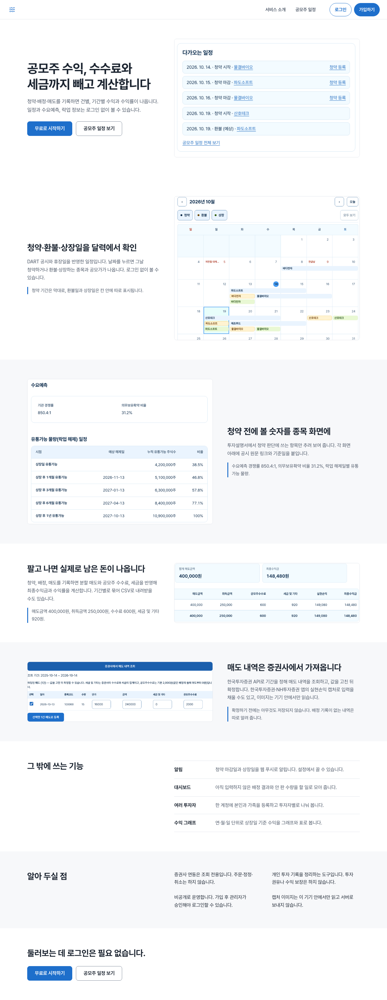
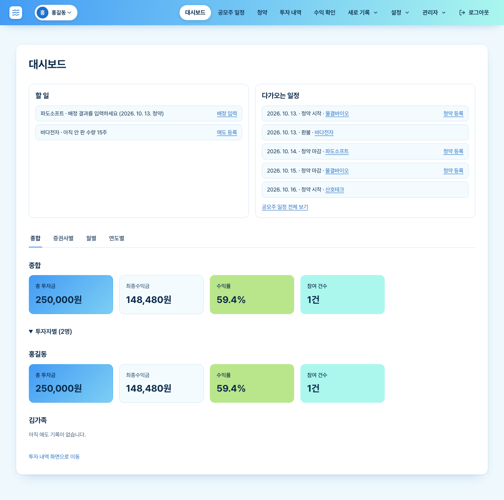

# IPO Calc (공모주계산기)
 
🇺🇸 English | [🇰🇷 한국어](#-공모주계산기-한국어)
 
**Track Korean IPO subscription profits for yourself and your whole family, across every brokerage account, in one place.**
 
IPO Calc is an open-source web app for people who subscribe to IPOs (공모주) on behalf of several family members and are tired of juggling one spreadsheet per account. It works just as well if you only manage your own account.
 
> **Status:** early-stage, actively developed. Feedback and contributions are welcome.
 
---
 
## Features
 
- **Multi-tenant by design**: log in with one ID, add multiple users (spouse, parents, children), and view everything per user.
- **Per-account tracking**: record IPO subscriptions for each brokerage account and see profits per account.
- **IPO schedule**: see upcoming and past IPO schedules in one view.
- **Profit calculation**: calculated profits at a glance, per user, per account, and overall.
- **Works solo too**: no family setup required; a single user is fully supported.
## Screenshots
 
All screenshots live in [`docs/user-guides/manual/screenshots/`](docs/user-guides/manual/screenshots/). The full walkthrough with annotated screens is in the [user guide](docs/user-guides/manual/pc.html).
 
| Landing page | Dashboard |
|---|---|
|  |  |
 
## Quick start
 
**1. Get the two required API keys**
 
| Variable | What it is | Where to get it |
|---|---|---|
| `OPENDART_API_KEY` | API key for OpenDART (Korea's corporate disclosure system) | https://opendart.fss.or.kr |
| `DATA_GO_KR_SERVICE_KEY` | Service key for the Korean public data portal (data.go.kr) | https://www.data.go.kr |
 
**2. Clone and configure**
 
```bash
git clone https://github.com/winter0123/ipo-calc.git
cd ipo-calc
 
# Create a .env file in the repository root (next to docker-compose.yml) with both keys:
cat > .env << 'EOF'
OPENDART_API_KEY=your_opendart_key
DATA_GO_KR_SERVICE_KEY=your_data_go_kr_key
EOF
```
 
> Never commit `.env`. It contains secrets (make sure it is listed in `.gitignore`).
 
**3. Run**
 
```bash
docker compose up -d
```
 
**4. Open the app**
 
Open `http://localhost` in your browser (add the port if your `docker-compose.yml` maps one, e.g. `http://localhost:8080`). For sign-up and first login, see the [user guide](docs/user-guides/manual/pc.html).
 
> The project is not deployed publicly yet, so running it locally is currently the only way to try it. There is no live demo; the user guide and screenshots show every screen.
 
## Tech stack
 
- Backend: [fill in: language / framework / database]
- Frontend: [fill in]
- Deployment: Docker Compose (`docker-compose.yml`), CI pipeline (`Jenkinsfile`), infrastructure configs (`infra/oracle`)
## Repository layout
 
| Path | What's inside |
|---|---|
| `backend/` | Server application |
| `ui/` | Web front end |
| `docs/` | Specs, architecture notes, user guides, agent prompt guides, work logs |
| `deploy/`, `infra/oracle/` | Deployment and infrastructure configuration |
| `scripts/`, `tools/` | Helper scripts and tooling (including agent watchdog scripts) |
| `AGENTS.md` | Rulebook for building software with multiple AI agents |
 
## Documentation
 
| I want to... | Read |
|---|---|
| Use the app | [User guide (PC)](docs/user-guides/manual/pc.html), with [screenshots](docs/user-guides/manual/screenshots/) |
| Build my own project with AI agents | [`AGENTS.md`](AGENTS.md) and the [agent prompt guide](#agent-prompt-guide) below |
| Run agents on free AI models | [Free AI models with OpenCode](#free-ai-models-with-opencode) below |
 
## Building with AI agents ("vibe coding")
 
This project was built with AI-assisted development, and the whole process is documented openly so you can reuse it.
 
**[`AGENTS.md`](AGENTS.md)** is a reusable rulebook for running a coordinator AI plus worker AIs on a software project. It covers:
 
- A coordinator-plus-workers structure, and when to create or release workers
- A research → spec → architecture → human approval → implementation workflow
- Human approval gates for risky decisions (data, security, cost)
- The rule that an agent saying "done" is not evidence: the coordinator re-runs tests and builds itself
- Shell-based watchdogs that detect stalled agents without spending tokens
- Cost-control lessons learned from real incidents
You can copy `AGENTS.md` into a new project as a starting point. (It is currently written in Korean; an English summary is planned.)
 
### Agent prompt guide
 
The `docs/` folder contains the prompts and templates used to run the agents, so you can adapt them instead of starting from scratch:
 
- Role prompts for the planning, backend, and frontend agents: [`docs/prompt-planning.md`](docs/prompt-planning.md), [`docs/prompt-backend.md`](docs/prompt-backend.md), [`docs/prompt-frontend.md`](docs/prompt-frontend.md)
- A self-contained task spec template for workers: [`docs/worker-spec-template.md`](docs/worker-spec-template.md)
- Project-specific agent settings: [`docs/project-agent-guide.md`](docs/project-agent-guide.md)
<!-- Verify these file names exist, and fix the links if they differ. -->
 
### Free AI models with OpenCode
 
Worker agents in this project run through [OpenCode](https://opencode.ai) on free models, so development costs stay low while a stronger model acts as coordinator and verifier. The guides record practical feedback from running this setup, including:
 
- Check that a free model is actually available, and supports tool calls, right before using it
- Tell temporary failures (429 / 5xx) apart from a daily quota being used up or a model that simply doesn't fit the role
- When a daily free quota runs out, don't keep retrying; switch to another free model after testing it with a single request
- A wrong model ID can silently fall back to a different model, so confirm which model is really running before assigning work
- Never switch to a paid model or service without explicit approval
Details and observed results: [`docs/project-agent-guide.md`](docs/project-agent-guide.md)
 
## Contributing
 
Issues and pull requests are welcome. Please open an issue first for larger changes.
 
## License
 
[MIT](LICENSE)
 
---
 
# 🇰🇷 공모주계산기 (한국어)
 
[🇺🇸 English](#ipo-calc-공모주계산기)
 
**공모주 수익금을 나 혼자뿐 아니라 가족의 여러 증권계좌까지 한곳에서 관리하세요.**
 
가족의 공모주 청약을 대신 관리하면서 계좌마다 엑셀을 따로 만들어 쓰는 분들을 위한 오픈소스 웹 서비스입니다. 혼자 쓰는 경우에도 그대로 사용할 수 있습니다.
 
> **상태:** 초기 단계이며 활발히 개발 중입니다. 피드백과 기여를 환영합니다.
 
---
 
## 주요 기능
 
- **멀티테넌트 구조**: 하나의 아이디로 로그인해 가족 등 여러 사용자를 추가하고, 사용자별로 볼 수 있습니다.
- **계좌별 관리**: 증권계좌마다 공모주 청약 내역과 수익금을 확인합니다.
- **공모주 일정**: 예정·지난 공모주 일정을 한눈에 봅니다.
- **수익금 계산**: 사용자별, 계좌별, 전체 수익금을 한눈에 확인합니다.
- **혼자 사용도 가능**: 가족 구성 없이 한 명만 써도 됩니다.
## 스크린샷
 
모든 스크린샷은 [`docs/user-guides/manual/screenshots/`](docs/user-guides/manual/screenshots/)에 있습니다. 화면별 설명이 있는 전체 안내는 [사용 가이드](docs/user-guides/manual/pc.html)에서 볼 수 있습니다.
 
| 랜딩 페이지 | 대시보드 |
|---|---|
|  |  |
 
## 빠른 시작
 
**1. 필수 API 키 2개 발급받기**
 
| 변수 | 설명 | 발급처 |
|---|---|---|
| `OPENDART_API_KEY` | 금융감독원 전자공시시스템(OpenDART) API 키 | https://opendart.fss.or.kr |
| `DATA_GO_KR_SERVICE_KEY` | 공공데이터포털(data.go.kr) 서비스 키 | https://www.data.go.kr |
 
**2. 내려받고 설정하기**
 
```bash
git clone https://github.com/winter0123/ipo-calc.git
cd ipo-calc
 
# 레포 루트(docker-compose.yml과 같은 위치)에 .env 파일을 만들고 두 키를 넣습니다:
cat > .env << 'EOF'
OPENDART_API_KEY=발급받은_opendart_키
DATA_GO_KR_SERVICE_KEY=발급받은_공공데이터포털_키
EOF
```
 
> `.env`는 절대 커밋하지 마세요. 비밀 키가 들어 있습니다 (`.gitignore`에 포함되어 있는지 확인하세요).
 
**3. 실행하기**
 
```bash
docker compose up -d
```
 
**4. 접속하기**
 
브라우저에서 `http://localhost`로 접속하세요. (`docker-compose.yml`에 포트가 지정되어 있다면 `http://localhost:8080`처럼 포트를 붙입니다.) 회원가입과 첫 로그인 방법은 [사용 가이드](docs/user-guides/manual/pc.html)를 참고하세요.
 
> 아직 외부에 배포하기 전이라 현재는 로컬에서 실행해 보는 방법만 제공합니다. 라이브 데모는 없고, 사용 가이드와 스크린샷에서 모든 화면을 볼 수 있습니다.
 
## 기술 스택
 
- 백엔드: [작성: 언어 / 프레임워크 / DB]
- 프론트엔드: [작성]
- 배포: Docker Compose (`docker-compose.yml`), CI 파이프라인 (`Jenkinsfile`), 인프라 설정 (`infra/oracle`)
## 폴더 구조
 
| 경로 | 내용 |
|---|---|
| `backend/` | 서버 애플리케이션 |
| `ui/` | 웹 프론트엔드 |
| `docs/` | 기획서, 설계 문서, 사용 가이드, 에이전트 프롬프트 가이드, 작업 로그 |
| `deploy/`, `infra/oracle/` | 배포 및 인프라 설정 |
| `scripts/`, `tools/` | 보조 스크립트와 도구 (에이전트 감시 스크립트 포함) |
| `AGENTS.md` | 여러 AI 에이전트로 소프트웨어를 개발하는 규칙서 |
 
## 문서 안내
 
| 이럴 때 | 읽을 문서 |
|---|---|
| 앱을 사용하고 싶다 | [사용 가이드 (PC)](docs/user-guides/manual/pc.html), [스크린샷](docs/user-guides/manual/screenshots/) |
| AI 에이전트로 내 프로젝트를 만들고 싶다 | [`AGENTS.md`](AGENTS.md), 아래 [에이전트 프롬프트 가이드](#에이전트-프롬프트-가이드) |
| 무료 AI 모델로 에이전트를 돌리고 싶다 | 아래 [OpenCode로 무료 AI 모델 사용하기](#opencode로-무료-ai-모델-사용하기) |
 
## AI 에이전트로 개발하기 (바이브코딩)
 
이 프로젝트는 AI의 도움으로 만들었고, 그 과정을 전부 공개해 두었습니다. 그대로 가져다 쓸 수 있어요.
 
**[`AGENTS.md`](AGENTS.md)**는 코디네이터 AI와 작업자 AI를 함께 운영하는 재사용 가능한 규칙서입니다.
 
- 코디네이터 + 작업자 구조, 작업자를 만들고 정리하는 시점
- 조사 → 기획 → 설계 → 사람 승인 → 구현으로 이어지는 개발 흐름
- 데이터·보안·비용처럼 위험한 결정에서 사람 승인을 받는 지점
- 에이전트의 "완료했습니다"는 증거가 아니며, 코디네이터가 테스트와 빌드를 직접 다시 실행한다는 원칙
- 토큰을 쓰지 않고 멈춘 에이전트를 감지하는 셸 감시 스크립트
- 실제 사고에서 얻은 비용 절감 교훈
새 프로젝트에 `AGENTS.md`를 복사해서 출발점으로 쓸 수 있습니다. (현재 한국어로 작성되어 있으며, 영어 요약을 추가할 예정입니다.)
 
### 에이전트 프롬프트 가이드
 
`docs/` 폴더에 에이전트를 굴리는 데 쓴 프롬프트와 템플릿이 있어서, 처음부터 만들지 않고 가져다 고쳐 쓸 수 있습니다.
 
- 기획·백엔드·프론트엔드 에이전트용 역할 프롬프트: [`docs/prompt-planning.md`](docs/prompt-planning.md), [`docs/prompt-backend.md`](docs/prompt-backend.md), [`docs/prompt-frontend.md`](docs/prompt-frontend.md)
- 작업자에게 주는 자기완결형 작업 지시서 템플릿: [`docs/worker-spec-template.md`](docs/worker-spec-template.md)
- 프로젝트 전용 에이전트 설정: [`docs/project-agent-guide.md`](docs/project-agent-guide.md)
<!-- 위 파일 이름이 실제로 있는지 확인하고, 다르면 링크를 고치세요. -->
 
### OpenCode로 무료 AI 모델 사용하기
 
이 프로젝트의 작업자 에이전트는 [OpenCode](https://opencode.ai)를 통해 무료 모델로 실행하고, 더 강한 모델은 코디네이터·검증 역할만 맡습니다. 그래서 개발 비용이 낮게 유지됩니다. 이 구성을 실제로 운영하며 얻은 피드백이 가이드에 정리되어 있습니다.
 
- 무료 모델은 사용하기 직전에 실제로 쓸 수 있는지, 도구 호출을 지원하는지 확인합니다.
- 일시적인 오류(429 / 5xx)와 일일 무료 한도 소진, 역할에 맞지 않는 모델을 구분합니다.
- 일일 무료 한도가 다 떨어지면 재시도하지 않고, 요청 한 번으로 테스트한 뒤 다른 무료 모델로 바꿉니다.
- 잘못된 모델 ID는 오류 없이 다른 모델로 바뀔 수 있으니, 작업을 맡기기 전에 실제로 어떤 모델이 실행 중인지 확인합니다.
- 명시적 승인 없이는 유료 모델이나 서비스로 바꾸지 않습니다.
자세한 내용과 관찰 결과: [`docs/project-agent-guide.md`](docs/project-agent-guide.md)
 
## 기여하기
 
이슈와 풀 리퀘스트를 환영합니다. 큰 변경은 먼저 이슈로 의논해 주세요.
 
## 라이선스
 
[MIT](LICENSE)
